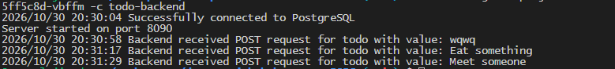

# Devops With Kubernetes 2026

## Exercises
- [Exercise 1.1](https://github.com/samuel-jinadu/devops-with-kubernetes-2026/tree/1.1)
- [Exercise 1.2](https://github.com/samuel-jinadu/devops-with-kubernetes-2026/tree/1.2)
- [Exercise 1.3](https://github.com/samuel-jinadu/devops-with-kubernetes-2026/tree/1.3)
- [Exercise 1.4](https://github.com/samuel-jinadu/devops-with-kubernetes-2026/tree/1.4)
- [Exercise 1.5](https://github.com/samuel-jinadu/devops-with-kubernetes-2026/tree/1.5)
- [Exercise 1.6](https://github.com/samuel-jinadu/devops-with-kubernetes-2026/tree/1.6)
- [Exercise 1.7](https://github.com/samuel-jinadu/devops-with-kubernetes-2026/tree/1.7)
- [Exercise 1.8](https://github.com/samuel-jinadu/devops-with-kubernetes-2026/tree/1.8)
- [Exercise 1.9](https://github.com/samuel-jinadu/devops-with-kubernetes-2026/tree/1.9)
- [Exercise 1.10](https://github.com/samuel-jinadu/devops-with-kubernetes-2026/tree/1.10)
- [Exercise 1.11](https://github.com/samuel-jinadu/devops-with-kubernetes-2026/tree/1.11)
- [Exercise 1.12](https://github.com/samuel-jinadu/devops-with-kubernetes-2026/tree/1.12)
- [Exercise 1.13](https://github.com/samuel-jinadu/devops-with-kubernetes-2026/tree/1.13)
- [Exercise 2.1](https://github.com/samuel-jinadu/devops-with-kubernetes-2026/tree/2.1)
- [Exercise 2.2](https://github.com/samuel-jinadu/devops-with-kubernetes-2026/tree/2.2)
- [Exercise 2.3](https://github.com/samuel-jinadu/devops-with-kubernetes-2026/tree/2.3)
- [Exercise 2.4](https://github.com/samuel-jinadu/devops-with-kubernetes-2026/tree/2.4)
- [Exercise 2.5](https://github.com/samuel-jinadu/devops-with-kubernetes-2026/tree/2.5)
- [Exercise 2.6](https://github.com/samuel-jinadu/devops-with-kubernetes-2026/tree/2.6)
- [Exercise 2.7](https://github.com/samuel-jinadu/devops-with-kubernetes-2026/tree/2.7)
- [Exercise 2.8](https://github.com/samuel-jinadu/devops-with-kubernetes-2026/tree/2.8)
- [Exercise 2.9](https://github.com/samuel-jinadu/devops-with-kubernetes-2026/tree/2.9)
- [Exercise 2.10](https://github.com/samuel-jinadu/devops-with-kubernetes-2026/tree/2.10)
- [Exercise 3.1](https://github.com/samuel-jinadu/devops-with-kubernetes-2026/tree/3.1)
- [Exercise 3.2](https://github.com/samuel-jinadu/devops-with-kubernetes-2026/tree/3.2)
- [Exercise 3.3](https://github.com/samuel-jinadu/devops-with-kubernetes-2026/tree/3.3)
- [Exercise 3.4](https://github.com/samuel-jinadu/devops-with-kubernetes-2026/tree/3.4)
- [Exercise 3.5](https://github.com/samuel-jinadu/devops-with-kubernetes-2026/tree/3.5)
- [Exercise 3.6](https://github.com/samuel-jinadu/devops-with-kubernetes-2026/tree/3.6)
- [Exercise 3.7](https://github.com/samuel-jinadu/devops-with-kubernetes-2026/tree/3.7)
- [Exercise 3.8](https://github.com/samuel-jinadu/devops-with-kubernetes-2026/tree/3.8)
- [Exercise 3.9](https://github.com/samuel-jinadu/devops-with-kubernetes-2026/tree/3.9)
- [Exercise 3.10](https://github.com/samuel-jinadu/devops-with-kubernetes-2026/tree/3.10)
- [Exercise 3.11](https://github.com/samuel-jinadu/devops-with-kubernetes-2026/tree/3.11)
- [Exercise 3.12](https://github.com/samuel-jinadu/devops-with-kubernetes-2026/tree/3.12)

# Logs Screenshot

*Couldnt get access to the true GCP, so had to improvise: Log Screenshot*

## Pros and Cons of DBaaS vs DIY

### DIY Postgres (self-hosted on GKE with PVCs)

**Pros**
- **Costs to initialize**: No additional service fees beyond the GKE cluster you already pay for; you only pay for the PersistentVolume storage (and compute you already provision). 

**Cons**
- **Work to initialize**: You must write and maintain the Deployment/StatefulSet, PVC, Service, Secret for credentials, and a backup CronJob.
- **Maintenance burden**: You are responsible for version upgrades, security patching, minor/major Postgres upgrades (which are nontrivial with PVCs), and monitoring disk usage. 

### DBaaS (Google Cloud SQL for Postgres)

**Pros**
- **Work to initialize**: Very little: No YAML for storage, no StatefulSet.
- **Maintenance**: Google handles patching, minor version upgrades, disk growth, and instance health. 

**Cons**
- **Costs** — You pay for the instance (vCPU/RAM), storage, and backups on top of the GKE cluster. 

## Notes
- Deploy: `./deploy-gke.sh`
- Compatibile with true GKE and floci-gcp GKE simulation
- Extract config for lens: `kubectl config view --minify --raw`
- Port-forward: `kubectl port-forward pod/my-pod TO_PORT:FROM_PORT` # Note: This command is blocking
- Sabotaging pods: `kubectl delete pod -l app=todo-app`

## Sources
- .devcontainer code originally based on [lbrenman/k3d-codespace](https://github.com/lbrenman/k3d-codespace), adapted for the floci-gcp GKE emulator.